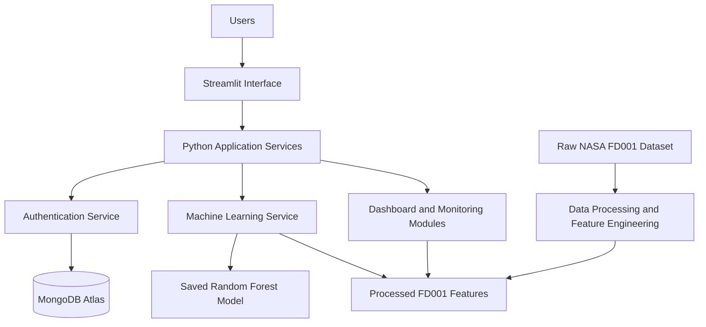

# Predictive Maintenance of Industrial Equipment Using Machine Learning

<p align="center">
  <strong>Machine Learning | Random Forest | Streamlit | MongoDB Atlas</strong>
</p>

An interactive machine learning application that estimates the Remaining Useful Life (RUL) of turbofan engines using the NASA C-MAPSS FD001 dataset. This project combines a trained Random Forest regression model, an interactive Streamlit dashboard, historical engine analysis, and simulated engine monitoring.

**Project Type:** Academic Group Project  
**Repository:** [Predictive-Maintenance-ML](https://github.com/Shibani-09/-Predictive-Maintenance-ML)

> **Monitoring scope:** The monitoring module replays historical records from the processed NASA dataset. It does not connect to physical industrial equipment, live sensors, or IoT devices.

---

## 1. Project Overview

Predictive maintenance uses equipment operating conditions and historical data to help identify potential maintenance requirements before equipment failure.

Remaining Useful Life (RUL) estimates the number of operating cycles an engine may have remaining before reaching the end of its useful life. Such estimates can help prioritize inspections and support maintenance planning.

This project applies supervised machine learning to historical engine operating settings and sensor-derived features from the NASA C-MAPSS FD001 dataset.

A trained Random Forest regression model estimates engine RUL in operating cycles. The Streamlit application presents these predictions through an interactive dashboard with engine-level analysis, model evaluation results, and simulated monitoring.

## 2. Problem Statement

Traditional maintenance approaches often depend on fixed maintenance schedules or respond only after equipment failure. These approaches may result in unnecessary maintenance, unexpected downtime, and inefficient resource planning.

This project explores how machine learning can use historical engine degradation patterns to estimate Remaining Useful Life and provide an accessible interface for examining engine health.

## 3. Project Objectives

- Prepare engine-cycle records and RUL targets using the NASA C-MAPSS FD001 dataset.
- Use a trained Random Forest regression model to estimate Remaining Useful Life.
- Develop an interactive Streamlit application for engine-level predictions.
- Present saved machine learning evaluation results and visualizations.
- Implement simulated engine monitoring using historical test records.
- Integrate MongoDB Atlas for application user account storage.

## 4. Key Features

| Feature | Description |
|---|---|
| User Authentication | Account registration and login with bcrypt password hashing. |
| Home Dashboard | Displays application, model, dataset, and MongoDB status. |
| Engine Prediction | Estimates RUL using the latest processed record of a selected test engine. |
| Sensor Trend Analysis | Displays historical sensor trends for a selected engine and sensor channel. |
| Simulated Monitoring | Replays engine records cycle by cycle and generates predictions for selected records. |
| Model Performance | Presents saved evaluation metrics, dataset summaries, and model visualizations. |
| Health Classification | Assigns engine health categories based on predicted RUL. |
| Maintenance Recommendations | Provides recommendations based on the predicted RUL category. |

### Engine Health Classification

The application uses the following RUL thresholds:

| Health Category | Predicted RUL |
|---|---:|
| Critical | 30 cycles or less |
| Warning | Above 30 and up to 60 cycles |
| Monitor | Above 60 and up to 120 cycles |
| Healthy | Above 120 cycles |

These categories are application-defined indicators and should be treated as decision-support information rather than guaranteed failure predictions.

## 5. Technology Stack

| Area | Technologies |
|---|---|
| Programming Language | Python |
| Application Interface | Streamlit |
| Machine Learning | Scikit-learn, Random Forest |
| Data Processing | Pandas, NumPy |
| Data Visualization | Matplotlib |
| Model Storage and Loading | Joblib |
| Database | MongoDB Atlas |
| Database Connectivity | PyMongo |
| Authentication | Passlib, bcrypt |
| Configuration | python-dotenv |
| Model Comparison | XGBoost |

**Note:** PyMySQL is included in the requirements for a separate legacy migration utility. MongoDB Atlas is the active database used by the Streamlit application.

## 6. System Architecture

The final application follows a direct Python-based architecture. Streamlit communicates with reusable Python services and modules, which access the saved machine learning model and processed dataset.

MongoDB Atlas is used for application account storage.



The Streamlit application directly uses Python modules. A separate REST API backend is not part of the final application architecture.

## 7. Application Workflow

1. **Dataset Preparation:** Raw NASA FD001 training, testing, and RUL files are processed to generate the required features.
2. **Model Development:** A trained Random Forest model and its feature-column configuration are saved as model artifacts.
3. **User Authentication:** Users register or log in through the Streamlit application. Account information is accessed through MongoDB Atlas.
4. **Engine Selection:** A user selects an engine from the available processed test data.
5. **RUL Prediction:** The prediction service selects the appropriate processed record, arranges the input features in the saved model-column order, and generates an RUL estimate.
6. **Health Classification:** The predicted RUL is mapped to an application-defined health category.
7. **Monitoring Simulation:** Users can replay historical engine records and view predictions for selected cycles.

## 8. Dataset Description

This project uses the **NASA C-MAPSS FD001 Turbofan Engine Degradation Dataset**.

The dataset contains simulated turbofan engine operational settings and sensor measurements across multiple operating cycles.

### Dataset Files

| File | Description |
|---|---|
| `train_FD001.txt` | Training engine-cycle records. |
| `test_FD001.txt` | Test engine-cycle records that end before the engines reach their final failure cycles. |
| `RUL_FD001.txt` | Remaining Useful Life values associated with the final observed test record of each engine. |

The raw dataset contains:

- Engine identifiers
- Operating cycle information
- Three operational settings
- Twenty-one sensor measurements

Processed training and testing feature files are available in `data/processed/`.

### Data Preprocessing and Feature Engineering

The existing preparation pipeline performs the following operations:

- Reads the raw whitespace-delimited FD001 files and assigns the appropriate column names.
- Calculates row-level Remaining Useful Life targets.
- Uses the final training cycle of each engine to calculate training RUL.
- Incorporates the supplied final-cycle RUL values when calculating test RUL.
- Removes sensor channels that remain constant in the training data.
- Sorts records by engine ID and operating cycle.
- Calculates five-cycle rolling means and standard deviations for sensor measurements.
- Generates per-sensor changes from the preceding operating cycle.
- Fills missing rolling-standard-deviation and first-cycle change values with zero.
- Saves the processed datasets as CSV files.

The processed files are:

- `data/processed/train_features.csv`
- `data/processed/test_features.csv`

The Streamlit application uses these prepared files rather than repeating feature engineering during each dashboard request.

## 9. Machine Learning Model

The application uses a previously trained **Random Forest Regressor** to estimate Remaining Useful Life.

### Saved Model Artifacts

| File | Purpose |
|---|---|
| `models/random_forest_rul_model.pkl` | Trained Random Forest regression model. |
| `models/feature_columns.pkl` | Saved list and ordering of model input features. |

Both artifacts are loaded using Joblib and cached within the Streamlit application.

### Prediction Process

1. The user selects a test engine.
2. The application retrieves the engine's processed records.
3. For the engine prediction page, the latest available processed record is selected.
4. For simulated monitoring, the selected historical cycle record is used.
5. Input features are arranged according to the saved feature-column configuration.
6. The trained Random Forest model generates an RUL estimate.
7. The application clamps negative predictions to zero and displays the result in operating cycles.

The application uses the saved model for prediction. It does not retrain the model when launched.

## 10. Model Evaluation and Performance

The project includes saved evaluation results comparing Random Forest and XGBoost regression models.

The training script uses an engine-based 80/20 training and validation split with random seed 42.

### Saved Validation Results

| Model | MAE (Cycles) | RMSE (Cycles) | R² Score |
|---|---:|---:|---:|
| Random Forest | 28.117 | 39.742 | 0.694 |
| XGBoost | 28.483 | 39.630 | 0.696 |

**Evaluation notes:**

- MAE represents the average absolute prediction error.
- RMSE gives greater weight to larger prediction errors.
- R² represents the proportion of variance explained by the regression model.
- These values are saved validation results, not guaranteed production performance.

The Streamlit application uses the saved Random Forest model.

### Evaluation Files

- `outputs/model_results.csv`
- `outputs/final_model_metrics.csv`
- `outputs/validation_predictions.csv`

### Available Visualizations

The `outputs/charts/` directory includes:

- Actual versus predicted RUL
- Feature importance
- Model comparison by MAE
- Model comparison by R²
- Prediction error distribution
- Engine RUL prediction visualization

## 11. Application Modules and Dashboard Pages

| Module | Functionality |
|---|---|
| Home Dashboard | Displays MongoDB status, model availability, test-engine count, and saved Random Forest metrics. |
| Engine Prediction | Selects a test engine, generates an RUL prediction, and displays historical sensor trends. |
| Model Performance | Displays processed dataset summaries, saved evaluation results, and visualizations. |
| Simulated Engine Monitoring | Replays selected engine test records and generates predictions for selected cycles. |
| Authentication Service | Handles registration, login, bcrypt password hashing, and account lockout after three failed login attempts. |
| Database Service | Connects to MongoDB Atlas and provides access to the users collection. |
| ML Service | Loads model artifacts and processed test data, prepares prediction inputs, and generates RUL estimates. |

### Additional Power BI Report

The repository also includes a Power BI dashboard:

`powerbi/Predictive_Maintenance_Dashboard.pbix`

It uses the prepared reporting dataset:

`powerbi/predictive_maintenance_dashboard.csv`

These are additional reporting artifacts and are separate from the Streamlit application's runtime workflow.

## 12. MongoDB Atlas Integration

MongoDB Atlas is used as the application's database for user account management.

The database service:

- Connects to MongoDB Atlas using PyMongo.
- Reads connection configuration from the root `.env` file.
- Uses the configured database name.
- Verifies database connectivity using a ping.
- Provides access to the `users` collection.

The authentication service uses the database for account registration and login. Passwords are stored as bcrypt hashes rather than plaintext passwords.

A separate migration utility is available at:

`scripts/migrate_mysql_to_mongodb.py`

This is a legacy account-migration utility and is not part of the active Streamlit application workflow.

## 13. Project Directory Structure

```text
Predictive-Maintenance-ML/
│
├── data/
│   ├── raw/
│   │   ├── RUL_FD001.txt
│   │   ├── test_FD001.txt
│   │   └── train_FD001.txt
│   │
│   └── processed/
│       ├── test_features.csv
│       └── train_features.csv
│
├── models/
│   ├── feature_columns.pkl
│   └── random_forest_rul_model.pkl
│
├── outputs/
│   ├── charts/
│   ├── predictions/
│   ├── feature_importance.csv
│   ├── final_model_metrics.csv
│   ├── model_results.csv
│   └── validation_predictions.csv
│
├── powerbi/
│   ├── Predictive_Maintenance_Dashboard.pbix
│   └── predictive_maintenance_dashboard.csv
│
├── scripts/
│   ├── migrate_mysql_to_mongodb.py
│   └── users_indexes_backup.json
│
├── src/
│   ├── config.py
│   ├── create_dashboard_data.py
│   ├── data_loader.py
│   ├── data_quality.py
│   ├── feature_engineering.py
│   ├── model_evaluation.py
│   ├── model_training.py
│   ├── prediction_analysis.py
│   ├── realtime_simulation.py
│   └── test_prediction.py
│
├── streamlit_app/
│   ├── pages/
│   │   ├── __init__.py
│   │   ├── engine_prediction.py
│   │   ├── model_performance.py
│   │   └── realtime_monitoring.py
│   │
│   ├── services/
│   │   ├── authentication.py
│   │   ├── database.py
│   │   └── ml_service.py
│   │
│   └── app.py
│
├── .gitattributes
├── .gitignore
└── requirements.txt
```

## 14. Installation and Setup

Follow these instructions to run the project on a Windows system.

### Prerequisites

- Python installed on your system.
- Git installed.
- Git LFS installed.
- A MongoDB Atlas account and database.

### Step 1: Clone the Repository

Initialize Git LFS and clone the repository:

```powershell
git lfs install

git clone https://github.com/Shibani-09/-Predictive-Maintenance-ML.git

cd -Predictive-Maintenance-ML

git lfs pull
```

Git LFS is required to download the large `.pkl` model artifacts.

### Step 2: Create a Virtual Environment

```powershell
python -m venv .venv
```

### Step 3: Activate the Virtual Environment

```powershell
.\.venv\Scripts\Activate.ps1
```

### Step 4: Install Dependencies

```powershell
python -m pip install -r requirements.txt
```

### Step 5: Configure MongoDB Atlas

Create a `.env` file in the root project directory.

Add your own MongoDB Atlas configuration:

```env
MONGODB_URI=your_mongodb_connection_string
MONGODB_DATABASE=your_database_name
```

Replace the placeholder values with your actual configuration.

**Security reminder:** Never upload your `.env` file, database credentials, passwords, or connection strings to GitHub.

## 15. Running the Application

After installing dependencies and configuring MongoDB Atlas, run the following command from the project root:

```powershell
python -m streamlit run streamlit_app/app.py
```

The application will open in your default browser.

The default local address is:

```text
http://localhost:8501
```

The application loads the existing trained model, feature configuration, and processed dataset. Model training is not performed when the application starts.

## 16. Limitations

- The monitoring module replays historical FD001 test records rather than receiving live industrial sensor data.
- The project currently focuses on the NASA C-MAPSS FD001 dataset.
- Model performance may differ when applied to other equipment, operating conditions, or datasets.
- The reported evaluation metrics are saved validation results and do not guarantee real-world performance.
- The application requires the saved model artifacts and processed feature files to be available.
- MongoDB Atlas connectivity is required for database-dependent authentication functionality.
- RUL estimates and health classifications are decision-support indicators and should not replace qualified maintenance decisions.

## 17. Future Scope

Potential improvements for future development include:

- Integration with validated live industrial sensor data.
- Testing with additional NASA C-MAPSS dataset subsets.
- Further investigation of anomaly detection techniques.
- Monitoring model performance and detecting data drift.
- Additional machine learning model comparisons.
- Maintenance scheduling and notification functionality.
- Improved monitoring and reporting capabilities.

These are proposed future improvements and are not represented as currently implemented features.

## 18. Project Contributors

This project was developed collaboratively as an academic group project. The work involved project planning, dataset preparation, machine learning development, application implementation, database integration, testing, and documentation.

## 19. Acknowledgements

- **NASA Prognostics Center of Excellence:** For providing the C-MAPSS turbofan engine degradation dataset.
- **Python Open-Source Community:** For the libraries and tools used in data processing, machine learning, visualization, and application development.
- **Streamlit:** For providing the framework used to develop the interactive dashboard.

**Dataset Reference:** [NASA Prognostics Data Repository](https://ti.arc.nasa.gov/tech/dash/groups/pcoe/prognostic-data-repository/)

---

<p align="center">
  <strong>Predictive Maintenance of Industrial Equipment Using Machine Learning</strong><br>
  Academic Group Project
</p>
